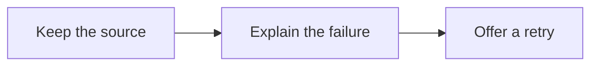

# A diagram can fail without losing the thought

This is an intentional syntax error. The source disclosure stays open, the error stays local to the diagram, and **Retry diagram** allows the reader to try again. Because the authored syntax remains invalid, retrying preserves the same clear failure state.

```mermaid
flowchart LR
  A[Draft] --> [This node is deliberately incomplete
```

## The next diagram still works

One failed diagram should leave the rest of the document useful.



The full set of valid examples is #artifact/2026-10-12-diagrams.
