# The shape of an idea

These diagrams render from local Mermaid fences using the same document pipeline as notes, project details, and Markdown attachments. Open **Diagram source** to inspect any example. Switch the app's theme to compare light and dark appearances.

## Flowchart · a decision with a path

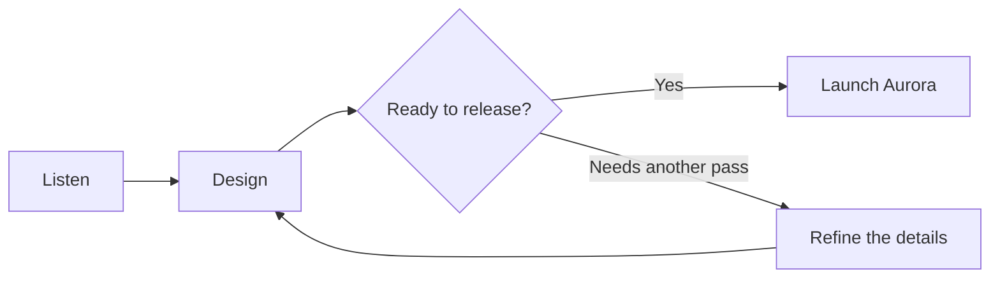

## Sequence · the conversation between parts

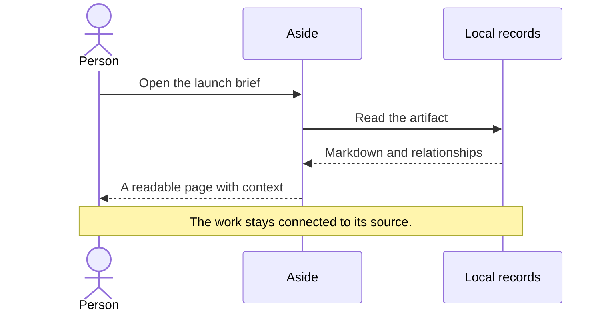

## Class diagram · a small content model

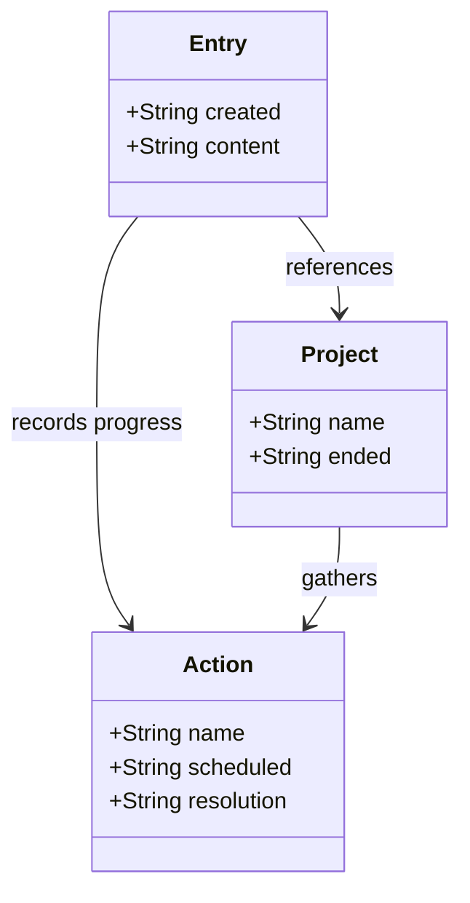

## State diagram · a piece of work changes

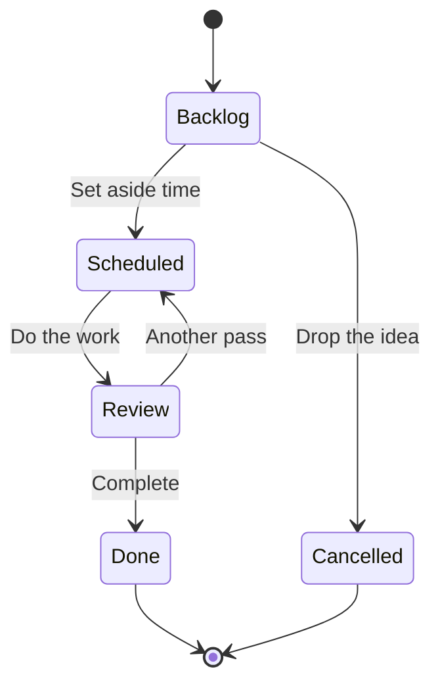

## Entity relationships · records belong together

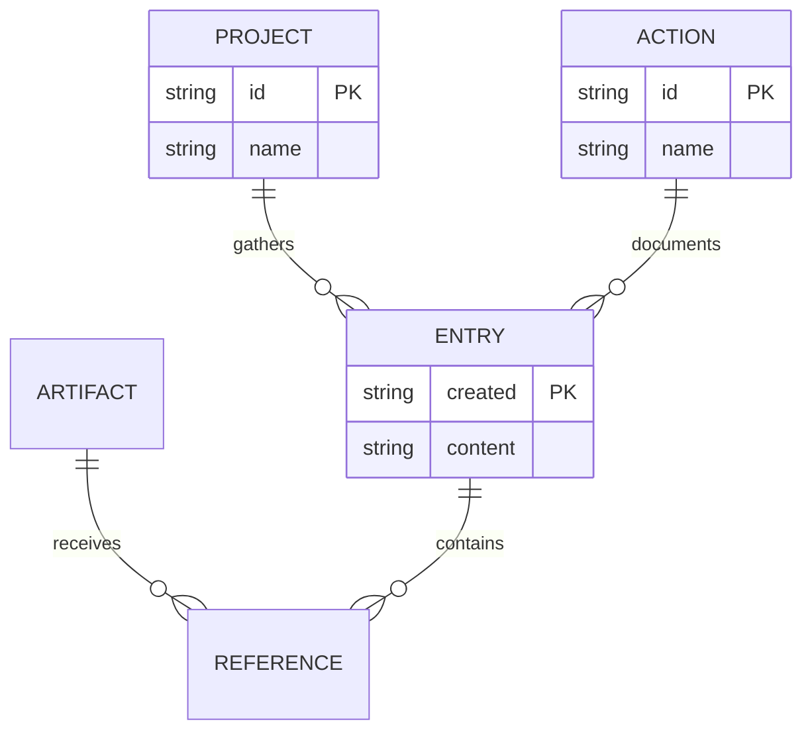

## Journey · how the launch should feel

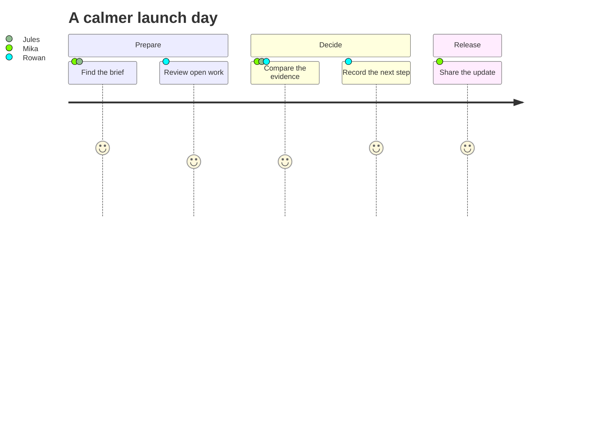

## Gantt · time for the work

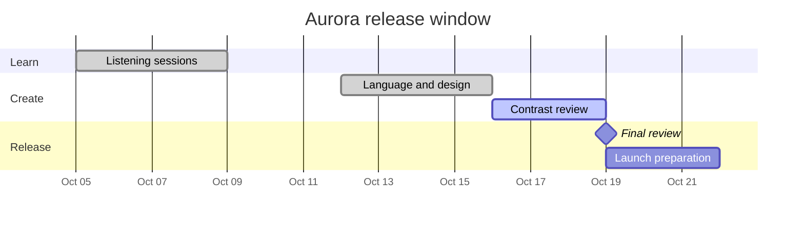

## Pie · a small summary of the whole

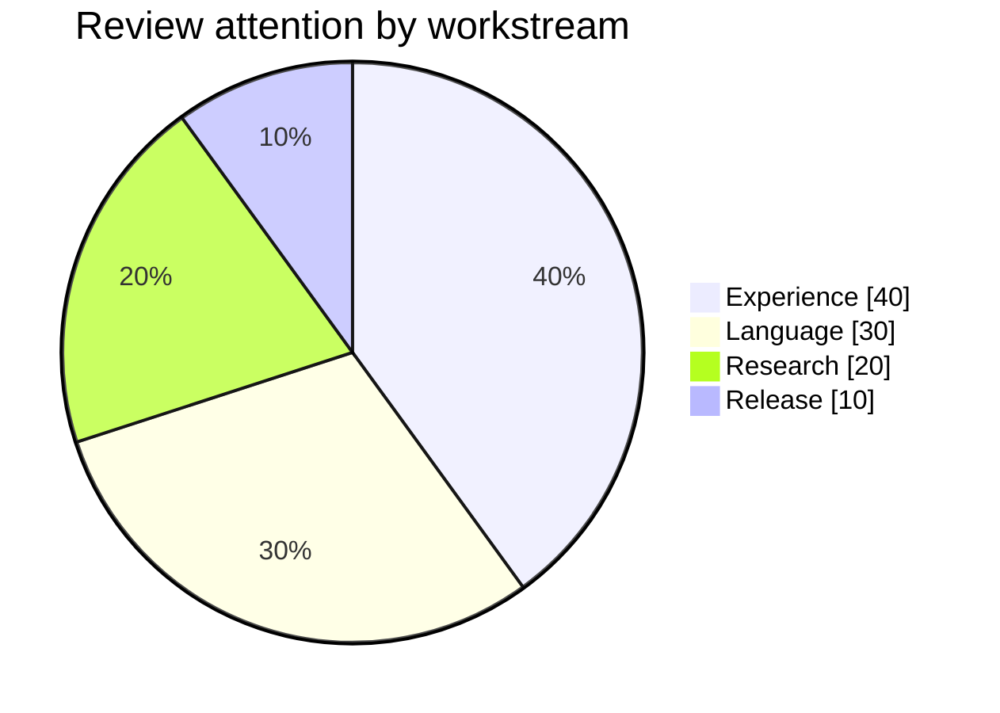

## Mindmap · begin with a central thought

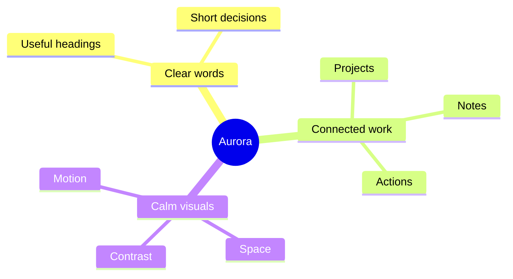

## Timeline · the thread across days

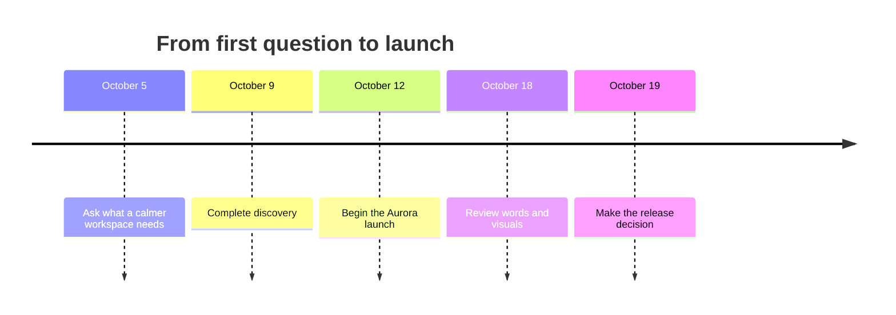

## Git graph · work converges

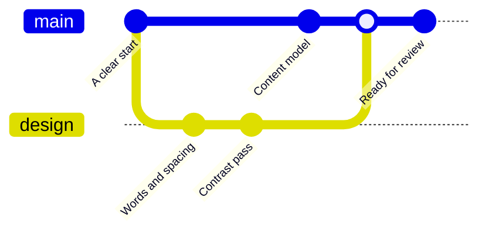

## Quadrant chart · compare two dimensions

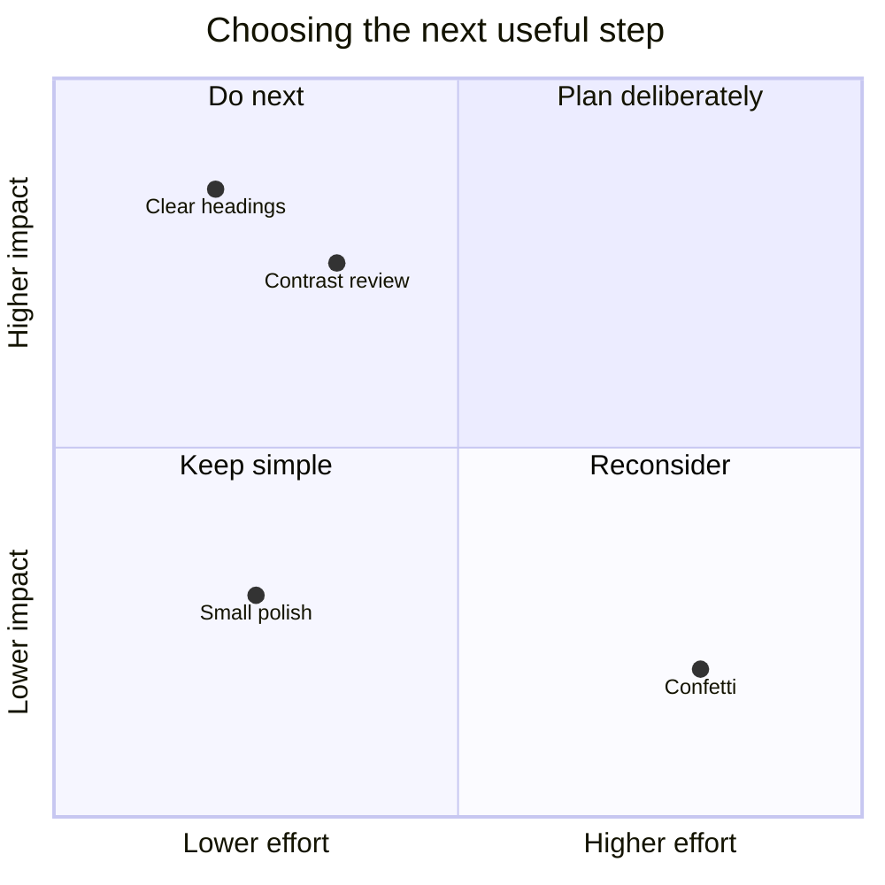

## XY chart · a trend across iterations

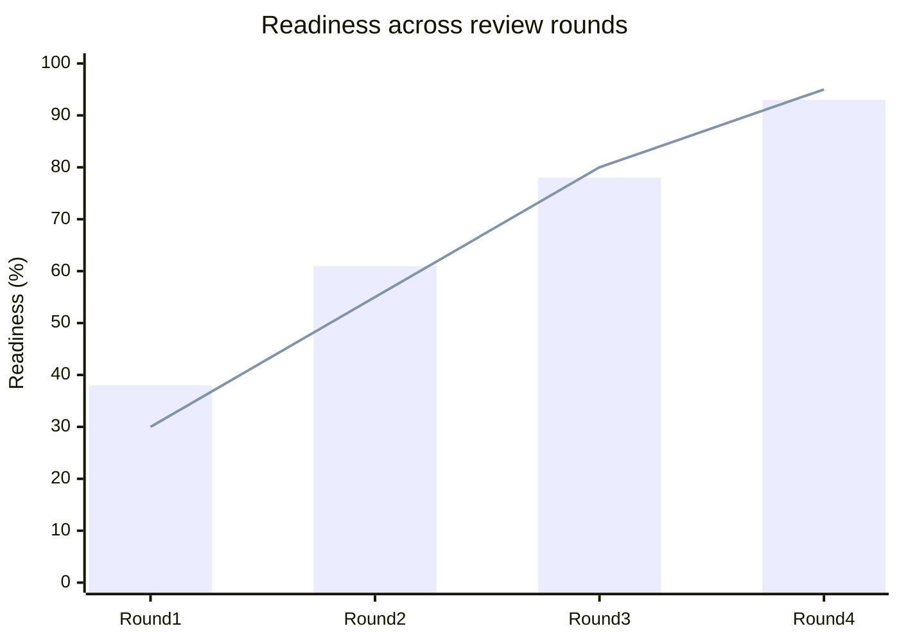

## Sankey · follow the distribution

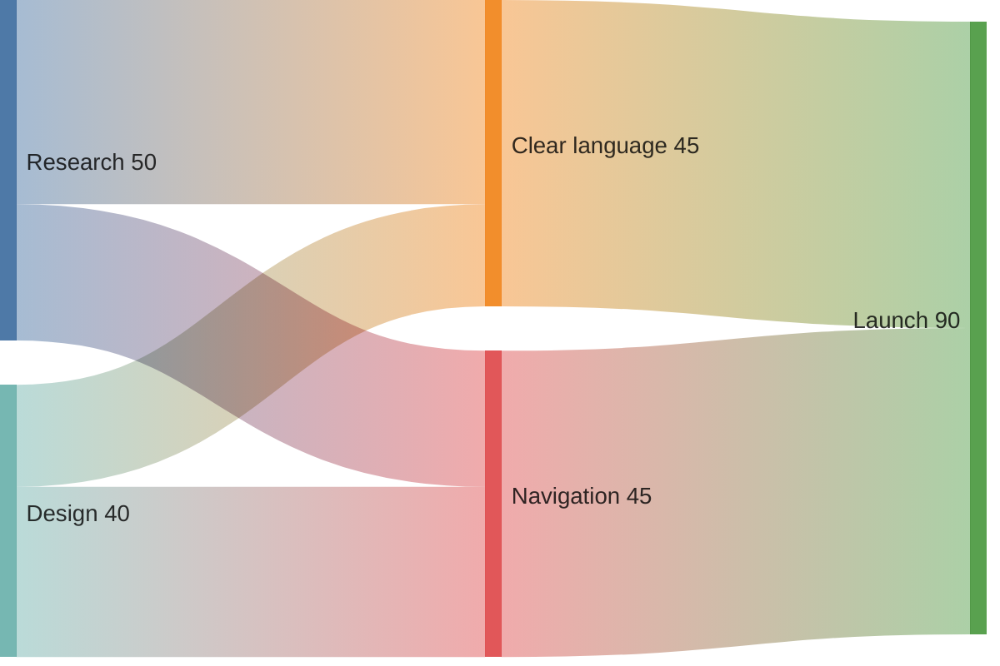

## Requirements · connect a need to evidence

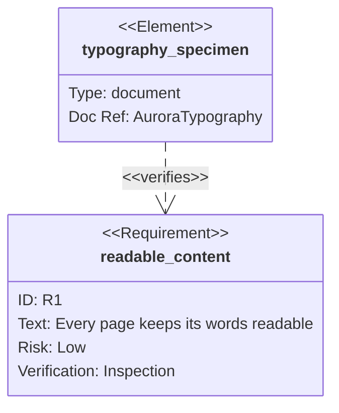

## Block diagram · a compact arrangement

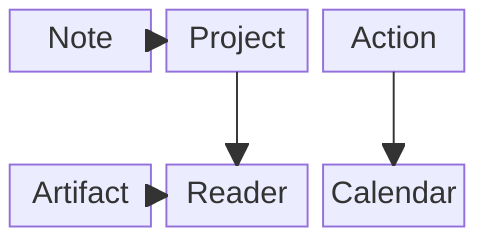

## Mathematical labels · precise ideas

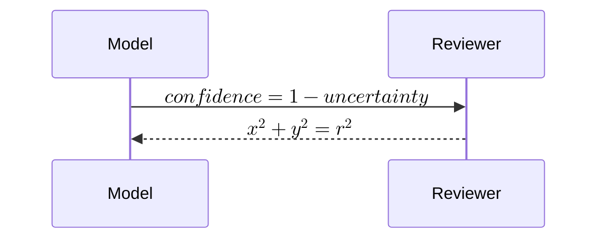

## Wide diagrams keep their labels readable

This deliberately wide chain scrolls inside its own output instead of shrinking all its words into a narrow column.

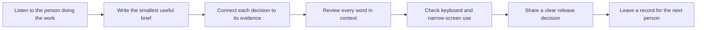

For interactive charts and filtering, open #artifact/2026-10-12-dashboard. For native media previews, open #artifact/2026-10-12-media.
