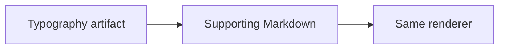

# The supporting file uses the same renderer

This attachment's front matter is omitted from its reading view. **Strong**, *emphasis*, `code`, entity references such as #project/2026-10-12-aurora, and artifact references such as #artifact/2026-10-12-diagrams behave like the parent document.

| Surface | Expected behavior |
| --- | --- |
| Attachment title | Exact filename |
| Parent link | Returns to Typography |
| References | Native, scoped destinations |

