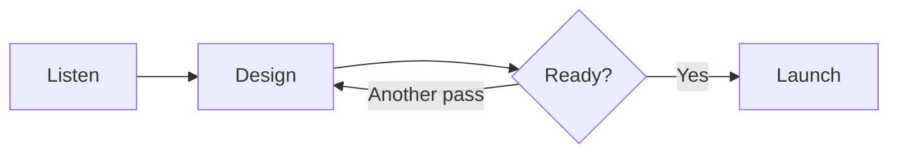

---
```entry
created: 2026-10-18T09:30
projects: [2026-10-12-aurora, 2026-10-12-design]
actions: [2026-10-12-review]
```

## A little clarity before the launch

Aurora is nearly ready. The plan is simple: make the next useful step visible, keep decisions connected to their evidence, and leave the next person a clear record.

The studio has four open doors:

- #artifact/2026-10-12-typography — every heading, list, table, reference, and line of code.
- #artifact/2026-10-12-diagrams — the shapes that explain architecture, progress, and decisions.
- #artifact/2026-10-12-media — local images, PDFs, audio, video, and supporting files.
- #artifact/2026-10-12-dashboard — an interactive chart and task explorer.

The final review is #action/2026-10-12-review at #date/2026-10-19T14:00[America/Los_Angeles]. [The launch checklist](../../assets/launch-checklist.md) keeps the last few steps together.

> Clear words, connected work, and a little space to think.

---
```entry
created: 2026-10-18T09:00
projects: [2026-10-12-aurora, 2026-10-12-design, 2026-10-12-research]
actions: [2026-10-12-backlog, 2026-10-12-slipped, 2026-10-12-due, 2026-10-12-overdue, 2026-10-12-done, 2026-10-12-cancelled, 2026-10-12-standup, 2026-10-12-global, 2026-10-12-long-name]
```

### Every kind of open thread

Today’s review puts the lifecycle treatments side by side: #action/2026-10-12-backlog, #action/2026-10-12-slipped, #action/2026-10-12-due, #action/2026-10-12-overdue, #action/2026-10-12-done, and #action/2026-10-12-cancelled.

The morning routine #action/2026-10-12-standup creates weekday calendar occurrences. #action/2026-10-12-global keeps its Tokyo time, and #action/2026-10-12-long-name tests labels at the edge of a narrow screen.

The tag rows intentionally hold enough projects and actions to fold behind their **+N** disclosure. Hover a reference to trace it through the flow.

---
```entry
created: 2026-10-18T08:15
projects: [2026-10-12-aurora, 2026-10-12-design]
actions: [2026-10-12-review]
```

### A quiet final pass

A calmer launch starts with a review that has a clear ending. We read the brief from beginning to end, checked the first useful action, and removed two sentences that repeated what the page already showed.

The remaining questions are small: whether the welcome note gives enough context, and whether the supporting links use names people will recognize. Both can be settled in the final review without adding another page to the experience.

---
```entry
created: 2026-10-17T14:00
projects: [2026-10-12-aurora, 2026-10-12-design]
actions: [2026-10-12-due]
```

# The words in context

## A clear second-level heading

Use **strong words** for a decision, *emphasis* for an inflection, ~~strike~~ for a dropped idea, and `exact values` for something a reader might copy.

### The plan, at a glance

1. Read the brief.
2. Compare the evidence.
   - A nested thought belongs with its parent.
   - Another detail can include a [labeled project](#project/2026-10-12-aurora).
3. Record the next step.

#### A small checklist

- [x] Keep the useful parts close together
- [ ] Review the final words

##### One precise note

> “Make it easy to return to the thought.”

###### A quiet final label

東京 · Montréal · São Paulo · مرحبا · 🌅

```typescript
const ready = review.words && review.visuals;
// #project/2026-10-12-aurora stays literal in code.
```

| Part | Choice | Why |
| --- | --- | --- |
| Heading | Plain language | Faster to scan |
| Body | Short paragraphs | Easier to return |
| Value | `42` | Exact to copy |

The complete specimen is #artifact/2026-10-12-typography.

---
```entry
created: 2026-10-17T11:00
projects: [2026-10-12-aurora, 2026-10-12-research]
actions: [2026-10-12-backlog]
```

### The return visit matters

In the latest listening session, the most useful moment came when someone returned after a few days away. They did not need a fresh introduction. They needed a calmer way to find the thought they had left unfinished.

We will make the welcome note point to the current brief and the last meaningful decision. The surrounding history can stay available without competing for attention. A useful return visit should take one small step, then let the person keep reading.

---
```entry
created: 2026-10-16T16:00
projects: [2026-10-12-aurora, 2026-10-12-design]
actions: [2026-10-12-review, 2026-10-12-overdue]
```

### Leave the evidence close

The contrast review is easier to follow when each observation sits beside its example. A calmer review does not need a separate status board; it needs the relevant evidence and a clear next decision in the same reading path.

We linked the remaining contrast question to the release discussion and recorded the reason for the current choice. Tomorrow, the reviewer can pick up the thread without reconstructing the conversation from several different places.

---
```entry
created: 2026-10-16T11:15
projects: [2026-10-12-aurora]
actions: [2026-10-12-review, 2026-10-12-overdue]
```

### The path to a release

A diagram belongs beside the decision it explains.



The complete family gallery is #artifact/2026-10-12-diagrams. The contrast audit #action/2026-10-12-overdue needs one more pass before #action/2026-10-12-review.

---
```entry
created: 2026-10-16T08:45
projects: [2026-10-12-aurora]
actions: [2026-10-12-standup]
```

### A smaller morning check-in

Today we tried a shorter check-in: one change since yesterday, one unresolved question, and one next step. That was enough to produce a calmer plan for the morning without turning the journal into a running list of every activity.

The media kit is already complete. The remaining work belongs to the launch words and the final review. We kept those references visible so the next person can move directly from the note to the supporting context.

---
```entry
created: 2026-10-15T15:30
projects: [2026-10-12-aurora, 2026-10-12-design]
actions: [2026-10-12-due]
```

### Names that explain the destination

We compared the link labels with the pages they open. The clearest labels use the words people already use in the conversation. A calmer interface can still be precise: the name should tell someone what they will find before they follow it.

The writing pass now has three checks: name the thing directly, keep the sentence short, and retain the reason for an important decision. The typography specimen remains a reference for how those words read at different widths.

---
```entry
created: 2026-10-15T10:00
projects: [2026-10-12-aurora, 2026-10-12-design]
actions: [2026-10-12-done]
```

The media kit is ready in #artifact/2026-10-12-media. We have a local illustration, a PDF brief, a gentle sound, and a tiny motion clip.


[Open the launch brief](#artifact/2026-10-12-media/launch-brief.pdf) or [read the local checklist](../../assets/launch-checklist.md). #action/2026-10-12-done is now complete.

---
```entry
created: 2026-10-15T08:30
projects: [2026-10-12-aurora, 2026-10-12-research]
actions: [2026-10-12-global]
```

### A handoff someone can finish

The research handoff is ready for the next time zone. We have made the open question explicit, linked the interviews that informed it, and left the proposed next step in plain language. This should make the next review feel calmer even when nobody is online at the same time.

A good handoff carries enough context to continue the work and enough restraint to avoid retelling the whole project. The earlier entries remain the record for anyone who wants to go deeper.

---
```entry
created: 2026-10-14T16:00
projects: [2026-10-12-aurora, 2026-10-12-research]
actions: [2026-10-12-global, 2026-10-12-long-name]
```

### A handoff across the Pacific

The next research session is #date/2026-10-20T09:00[Asia/Tokyo], with #action/2026-10-12-global holding the event's original zone.

| Research topic | Tokyo | Los Angeles | Montréal | Owner | Evidence | Next step |
| --- | --- | --- | --- | --- | --- | --- |
| Returning to a thought | Morning | Previous afternoon | Previous evening | Jules | Five interviews | Improve the handoff |
| Clear next actions | Morning | Previous afternoon | Previous evening | Mika | Usability sessions | Review the words |

The table should scroll inside the content column. The long reference #action/2026-10-12-long-name should wrap without widening the flow.

---
```entry
created: 2026-10-14T13:00
projects: [2026-10-12-aurora, 2026-10-12-design]
actions: [2026-10-12-review]
```

### Keep the useful part visible

We looked at the launch brief on a smaller screen. The main reading path still works when the surrounding detail is folded away. The calmer version gives the useful sentence enough room and lets the supporting material wait until someone asks for it.

The next pass will focus on the first paragraph and the names of the linked records. We do not need more decoration to explain where the work stands; the words and their relationships already carry most of that meaning.

---
```entry
created: 2026-10-14T09:15
projects: [2026-10-12-aurora]
actions: [2026-10-12-standup, 2026-10-12-backlog]
```

### What changed since the last review

The morning note now starts with what changed, rather than a complete project recap. A calmer catch-up lets someone read a few recent entries and understand the direction before opening a longer document.

Since the last review, the welcome note has a first outline, the media kit has a named owner, and the review questions have been reduced to a short list. Each change points back to the work it affects, so the journal stays useful after the meeting ends.

---
```entry
created: 2026-10-13T16:00
projects: [2026-10-12-aurora, 2026-10-12-design]
actions: [2026-10-12-cancelled]
```

### One decision, with its reason

We set aside the confetti experiment because it added motion without helping someone understand the next step. The calmer direction leaves more room for the launch brief and the work that still needs attention.

The cancelled action stays in the record with the reason attached. If the idea comes up again, we can revisit the evidence instead of treating it as a new question. Keeping that context is more useful than making the earlier discussion disappear.

---
```entry
created: 2026-10-13T10:00
projects: [2026-10-12-aurora, 2026-10-12-design]
actions: [2026-10-12-cancelled, 2026-10-12-backlog]
```

We chose a calm design direction for #project/2026-10-12-design. #action/2026-10-12-cancelled stays in the record because dropped ideas are part of how we got here.

> Leave enough space for the important thing to feel important.

Next, #action/2026-10-12-backlog needs a first draft. The small interactive overview is #artifact/2026-10-12-dashboard.

---
```entry
created: 2026-10-13T08:30
projects: [2026-10-12-aurora, 2026-10-12-research]
actions: [2026-10-12-backlog]
```

### Start with the question

The first draft of the welcome note opened with a list of features. We are trying a calmer opening: what is happening, why it matters, and where to go next. The details can follow once the reader has a reason to care about them.

The research notes suggest that people feel oriented when they can connect a current decision to a familiar project. We will keep those references close to the prose instead of asking the reader to learn another navigation structure.

---
```entry
created: 2026-10-12T16:30
projects: [2026-10-12-aurora, 2026-10-12-design]
actions: [2026-10-12-review]
```

### The brief after the first conversation

The first conversation gave us a smaller, clearer brief. We want a calmer place to catch up, follow a thought, and understand the work around it. The entry flow already carries that story; the supporting documents can hold the current understanding.

We recorded the open questions in the launch review and linked the writing specimen for reference. The next step is to read the whole path once, from an entry to its project and back, and see where the explanation becomes harder than it needs to be.

---
```entry
created: 2026-10-12T11:30
projects: [2026-10-12-aurora]
actions: [2026-10-12-standup]
```

### A few useful boundaries

Before the work grows, we agreed on a few boundaries for a calmer launch. Keep the main path easy to read. Put detail where someone can ask for it. Make every open question lead to a concrete piece of work or a recorded decision.

These are small choices, but they should help the journal remain useful as more notes arrive. We can change the supporting views later while keeping the underlying record understandable to the next person who opens it.

---
```entry
created: 2026-10-12T09:00
projects: [2026-10-12-aurora, 2026-10-12-design, 2026-10-12-research]
actions: [2026-10-12-review, 2026-10-12-standup]
```

## Begin with a useful brief

#project/2026-10-12-aurora brings design and research together. Our first note names the destination: **a calmer launch workspace**.

We will meet in #action/2026-10-12-standup, keep review materials in #artifact/2026-10-12-typography, and gather again for #action/2026-10-12-review.

Discovery is complete in #project/2026-10-05-discovery. The thread continues from #entry/2026-10-09T16:30.
