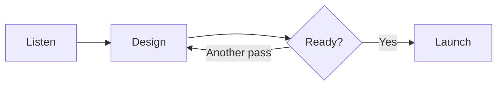

---
```entry
created: 2026-10-18T09:30
projects: [2026-10-12-aurora, 2026-10-12-design]
actions: [2026-10-12-review]
```

## A little clarity before the launch

Aurora is nearly ready. The plan is simple: make the next useful step visible, keep decisions connected to their evidence, and leave the next person a clear record.

The studio has four open doors:

- #artifact/2026-10-12-typography — every heading, list, table, reference, and line of code.
- #artifact/2026-10-12-diagrams — the shapes that explain architecture, progress, and decisions.
- #artifact/2026-10-12-media — local images, PDFs, audio, video, and supporting files.
- #artifact/2026-10-12-dashboard — an interactive chart and task explorer.

The final review is #action/2026-10-12-review at #date/2026-10-19T14:00[America/Los_Angeles]. [The launch checklist](../../assets/launch-checklist.md) keeps the last few steps together.

> Clear words, connected work, and a little space to think.

---
```entry
created: 2026-10-18T09:00
projects: [2026-10-12-aurora, 2026-10-12-design, 2026-10-12-research]
actions: [2026-10-12-backlog, 2026-10-12-slipped, 2026-10-12-due, 2026-10-12-overdue, 2026-10-12-done, 2026-10-12-cancelled, 2026-10-12-standup, 2026-10-12-global, 2026-10-12-long-name]
```

### Every kind of open thread

Today’s review puts the lifecycle treatments side by side: #action/2026-10-12-backlog, #action/2026-10-12-slipped, #action/2026-10-12-due, #action/2026-10-12-overdue, #action/2026-10-12-done, and #action/2026-10-12-cancelled.

The morning routine #action/2026-10-12-standup creates weekday calendar occurrences. #action/2026-10-12-global keeps its Tokyo time, and #action/2026-10-12-long-name tests labels at the edge of a narrow screen.

The tag rows intentionally hold enough projects and actions to fold behind their **+N** disclosure. Hover a reference to trace it through the flow.

---
```entry
created: 2026-10-17T14:00
projects: [2026-10-12-aurora, 2026-10-12-design]
actions: [2026-10-12-due]
```

# The words in context

## A clear second-level heading

Use **strong words** for a decision, *emphasis* for an inflection, ~~strike~~ for a dropped idea, and `exact values` for something a reader might copy.

### The plan, at a glance

1. Read the brief.
2. Compare the evidence.
   - A nested thought belongs with its parent.
   - Another detail can include a [labeled project](#project/2026-10-12-aurora).
3. Record the next step.

#### A small checklist

- [x] Keep the useful parts close together
- [ ] Review the final words

##### One precise note

> “Make it easy to return to the thought.”

###### A quiet final label

東京 · Montréal · São Paulo · مرحبا · 🌅

```typescript
const ready = review.words && review.visuals;
// #project/2026-10-12-aurora stays literal in code.
```

| Part | Choice | Why |
| --- | --- | --- |
| Heading | Plain language | Faster to scan |
| Body | Short paragraphs | Easier to return |
| Value | `42` | Exact to copy |

The complete specimen is #artifact/2026-10-12-typography.

---
```entry
created: 2026-10-16T11:15
projects: [2026-10-12-aurora]
actions: [2026-10-12-review, 2026-10-12-overdue]
```

### The path to a release

A diagram belongs beside the decision it explains.



The complete family gallery is #artifact/2026-10-12-diagrams. The contrast audit #action/2026-10-12-overdue needs one more pass before #action/2026-10-12-review.

---
```entry
created: 2026-10-15T10:00
projects: [2026-10-12-aurora, 2026-10-12-design]
actions: [2026-10-12-done]
```

The media kit is ready in #artifact/2026-10-12-media. We have a local illustration, a PDF brief, a gentle sound, and a tiny motion clip.


[Open the launch brief](#artifact/2026-10-12-media/launch-brief.pdf) or [read the local checklist](../../assets/launch-checklist.md). #action/2026-10-12-done is now complete.

---
```entry
created: 2026-10-14T16:00
projects: [2026-10-12-aurora, 2026-10-12-research]
actions: [2026-10-12-global, 2026-10-12-long-name]
```

### A handoff across the Pacific

The next research session is #date/2026-10-20T09:00[Asia/Tokyo], with #action/2026-10-12-global holding the event's original zone.

| Research topic | Tokyo | Los Angeles | Montréal | Owner | Evidence | Next step |
| --- | --- | --- | --- | --- | --- | --- |
| Returning to a thought | Morning | Previous afternoon | Previous evening | Jules | Five interviews | Improve the handoff |
| Clear next actions | Morning | Previous afternoon | Previous evening | Mika | Usability sessions | Review the words |

The table should scroll inside the content column. The long reference #action/2026-10-12-long-name should wrap without widening the flow.

---
```entry
created: 2026-10-13T10:00
projects: [2026-10-12-aurora, 2026-10-12-design]
actions: [2026-10-12-cancelled, 2026-10-12-backlog]
```

We chose a calm design direction for #project/2026-10-12-design. #action/2026-10-12-cancelled stays in the record because dropped ideas are part of how we got here.

> Leave enough space for the important thing to feel important.

Next, #action/2026-10-12-backlog needs a first draft. The small interactive overview is #artifact/2026-10-12-dashboard.

---
```entry
created: 2026-10-12T09:00
projects: [2026-10-12-aurora, 2026-10-12-design, 2026-10-12-research]
actions: [2026-10-12-review, 2026-10-12-standup]
```

## Begin with a useful brief

#project/2026-10-12-aurora brings design and research together. Our first note names the destination: **a calmer launch workspace**.

We will meet in #action/2026-10-12-standup, keep review materials in #artifact/2026-10-12-typography, and gather again for #action/2026-10-12-review.

Discovery is complete in #project/2026-10-05-discovery. The thread continues from #entry/2026-10-09T16:30.
